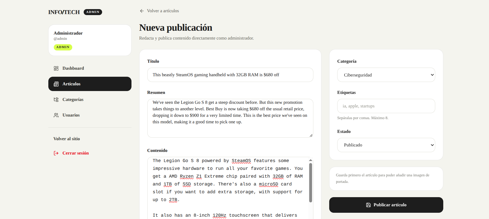
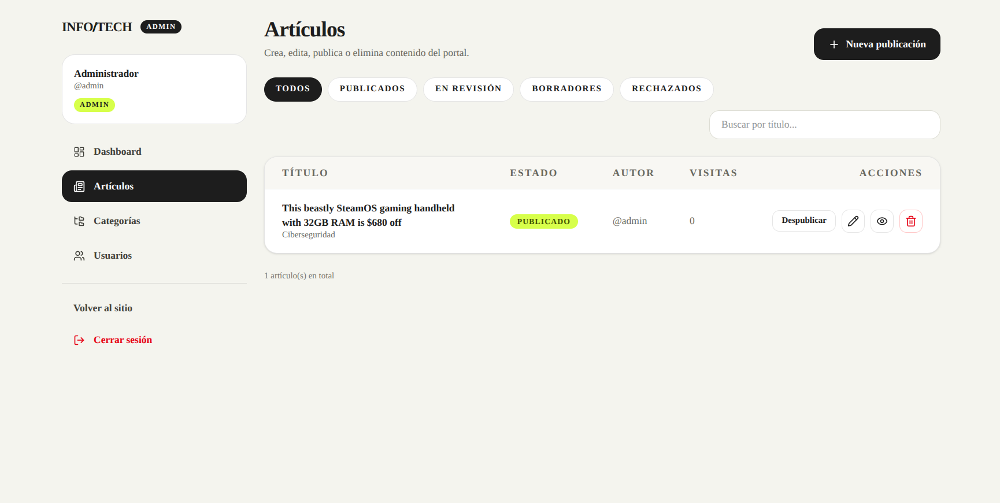
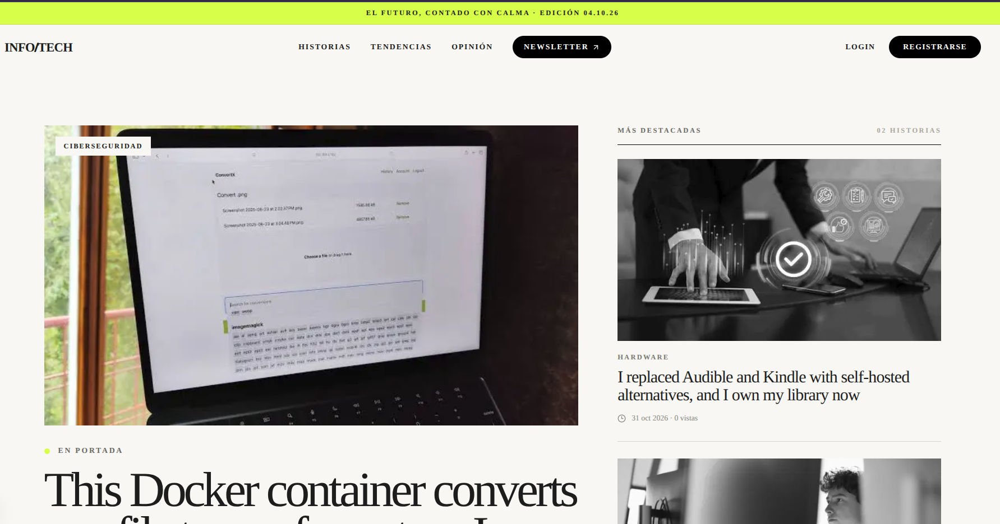
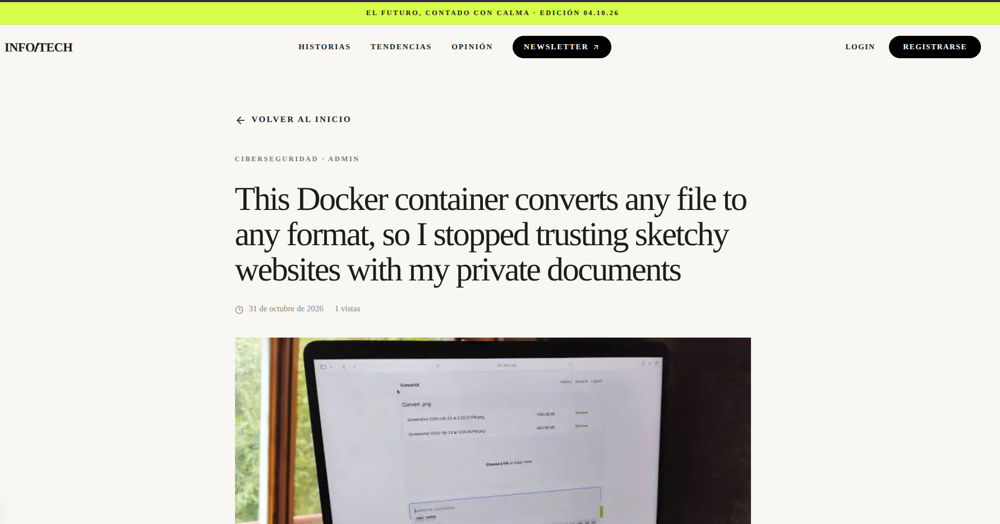

# InformaTech

Portal de noticias tecnológicas con panel de administración. Backend REST en **FastAPI**, frontend en **Next.js** y una interfaz editorial para crear, revisar y publicar artículos.

## Vista previa

### Panel de administración

El editor permite redactar el artículo, asignar categoría y etiquetas, subir una portada y elegir su estado de publicación.

<p align="center">
  
</p>

El listado de artículos incluye búsqueda, filtros por estado y acciones para editar, publicar, despublicar, previsualizar o eliminar.

<p align="center">
  
</p>

### Sitio público

La portada muestra una noticia destacada, las últimas historias y las categorías principales del portal.

<p align="center">
  
</p>

Vista de un artículo publicado, con portada, autoría, fecha y contenido completo.

<p align="center">
  
</p>

## Características

- **Portal público** responsive con noticias destacadas, últimas historias, categorías y newsletter.
- **Panel de administración** con estadísticas, CRUD de artículos, categorías y usuarios.
- **Flujo editorial**: `borrador → en revisión → publicado / rechazado`, con motivo de rechazo.
- **Roles y permisos**: `user`, `editor` y `admin`.
- **Autenticación JWT** con access token y refresh token.
- **Subida de portadas** con validación real de imagen, límite de tamaño y formatos JPEG/PNG/WEBP.
- **Búsqueda, filtros, orden y paginación** de artículos.
- **Contador de visitas** y artículos destacados.
- **API documentada** con Swagger/OpenAPI y tests automatizados.

## Stack

| Backend | Frontend | Datos e infraestructura |
|---|---|---|
| FastAPI · SQLAlchemy 2.x · Pydantic v2 | Next.js 16 · React 19 · TypeScript | SQLite (desarrollo) |
| Alembic · PyJWT · bcrypt · Pillow | Tailwind CSS 4 · shadcn/ui · Lucide | PostgreSQL (Docker/producción) |
| pytest · httpx | pnpm | Docker · Docker Compose |

## Estructura del proyecto

```text
.
├── app/                 # Backend FastAPI
│   ├── api/             # Endpoints y dependencias (auth, roles, paginación)
│   ├── core/            # Configuración, seguridad, excepciones y utilidades
│   ├── db/              # Base de SQLAlchemy y sesión
│   ├── models/          # User, Category, Tag, Article, Comment
│   ├── schemas/         # Esquemas Pydantic
│   └── services/        # Lógica de negocio
├── alembic/             # Migraciones de base de datos
├── tests/               # Tests con pytest
├── web/                 # Frontend Next.js
│   └── app/
│       ├── admin/       # Panel de administración
│       ├── noticias/    # Detalle de artículo
│       ├── (auth)/      # Login y registro
│       └── api/         # Route handlers que consumen la API
├── docs/images/         # Capturas para este README
└── scripts/             # Scripts de desarrollo y limpieza
```

## Arranque local (sin Docker)

Requisitos: Python 3.14, Node.js 22+ y pnpm.

```bash
# 1. Dependencias del backend
python3.14 -m venv .venv
.venv/bin/pip install -r requirements-dev.txt

# 2. Dependencias del frontend
cd web && pnpm install && cd ..

# 3. Configuración local (SQLite, no necesita PostgreSQL)
cp .env.example .env
# Edita SECRET_KEY en .env

# 4. Arranca backend + frontend (aplica migraciones y datos iniciales)
./scripts/dev.sh
```

Servicios:

- API / Swagger: <http://localhost:8000/docs>
- Frontend: <http://localhost:3000>
- Admin: `admin@example.com` / `Admin12345`

Para detener ambos servidores: `Ctrl+C`.

### Arrancarlos por separado

```bash
# Backend
.venv/bin/alembic upgrade head
.venv/bin/python -m app.initial_data
.venv/bin/uvicorn app.main:app --reload --port 8000

# Frontend (en otra terminal)
cd web && pnpm dev --port 3000
```

## Con Docker (PostgreSQL incluido)

Requiere Docker y Docker Compose instalados:

```bash
docker compose up --build
```

Si Docker no está instalado, usa el arranque local con SQLite de arriba.

## Variables de entorno

Las principales variables están documentadas en [`.env.example`](.env.example):

| Variable | Descripción |
|---|---|
| `DATABASE_URL` | Conexión a la base de datos (SQLite por defecto). |
| `SECRET_KEY` | Clave para firmar los JWT; obligatoria en producción. |
| `ACCESS_TOKEN_EXPIRE_MINUTES` | Duración del token de acceso. |
| `REFRESH_TOKEN_EXPIRE_DAYS` | Duración del refresh token. |
| `CORS_ORIGINS` | Orígenes permitidos por el backend. |
| `UPLOAD_DIR` / `MAX_UPLOAD_SIZE_MB` | Carpeta y límite de tamaño para portadas. |
| `FIRST_ADMIN_*` | Credenciales del administrador inicial. |

## Endpoints principales

Prefijo: `/api/v1`.

| Método | Ruta | Acceso |
|---|---|---|
| POST | `/auth/register`, `/auth/login`, `/auth/refresh` | Público |
| GET | `/articles` — filtros, búsqueda, orden y paginación | Público |
| GET | `/articles/{slug}` | Público |
| POST / PATCH / DELETE | `/articles`, `/articles/{id}` | Autor o moderador |
| POST | `/articles/{id}/submit` y `/articles/{id}/review` | Autor / editor |
| GET | `/articles/moderation/queue` | Editor / admin |
| GET / POST | `/articles/{slug}/comments` | Público / autenticado |
| GET / POST / PUT / DELETE | `/categories` | Público / admin |
| GET / PATCH | `/users`, `/users/{id}` | Admin |

La referencia completa está disponible en Swagger (`/docs`) y en [DOCUMENTACION.md](DOCUMENTACION.md).

## Tests

```bash
.venv/bin/pytest
```

Los tests cubren autenticación, permisos, categorías, flujo de moderación, filtros, comentarios y subida de portadas.

## Documentación

- [DOCUMENTACION.md](DOCUMENTACION.md): arquitectura, modelo de datos, decisiones técnicas y detalle de endpoints.
- Swagger: <http://localhost:8000/docs>
- ReDoc: <http://localhost:8000/redoc>
